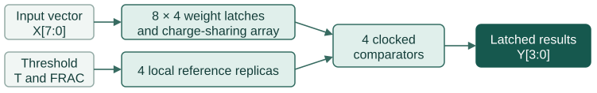
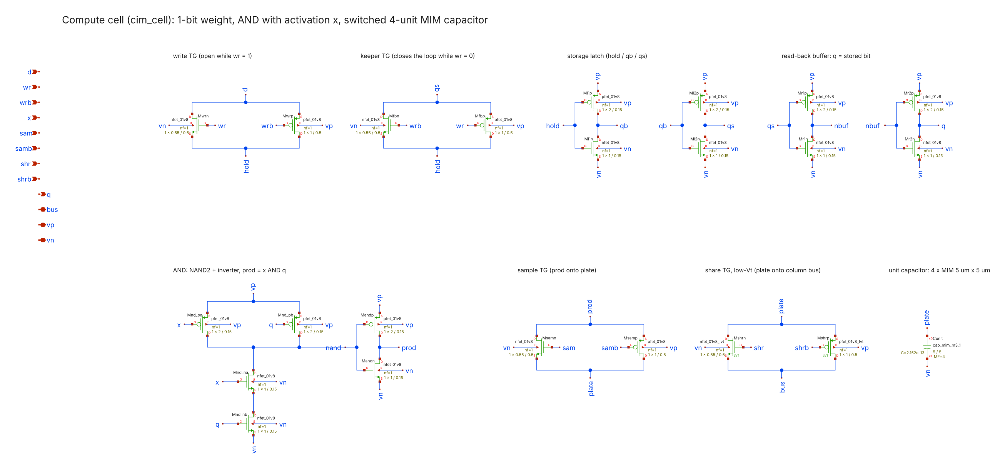
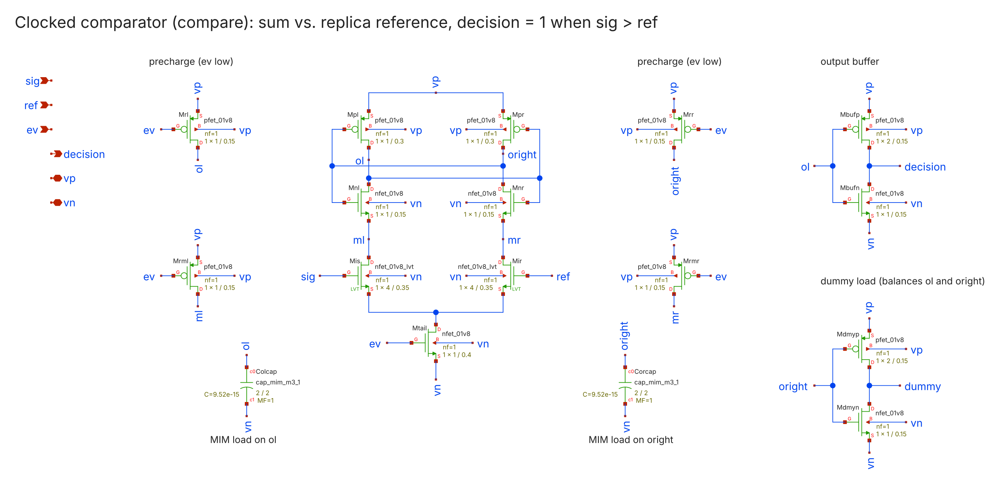
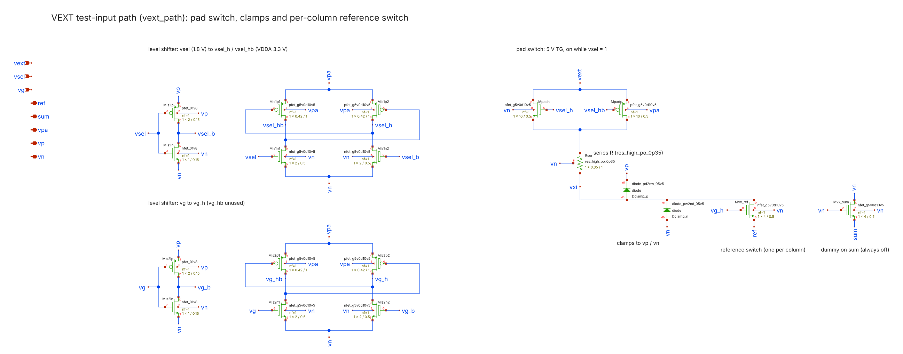

# 8×4 Charge-Domain Compute-in-Memory Macro for Binary Feature Detection

Nov 22, 2026 · Chipalooza Challenge #4 · SkyWater SKY130 · IP block proposal

## At a glance

`sky130_miloudias_ip__cim8x4` stores four 8-bit binary templates and compares an 8-bit input against all four in one 4 µs evaluation, returning four threshold decisions. In normal operation it needs no external reference, bias current or analog pad, so an SoC integrates it as a purely digital peripheral. A count mode returns the exact overlap for all four columns, and a test-only external reference lets the silicon's analog levels be measured directly.

A transistor-level schematic prototype and a synthesizable controller already exist. All 428 directed transistor-level decisions in the regression pass at a 10⁻⁴ solver tolerance, including endpoint checks at all 45 process, voltage and temperature combinations and eight local-mismatch seeds (section 6). Count mode, a narrower control interface and the external-reference test path were added after the prototype and are already implemented and simulated (section 6.5).

| Item | Value |
| --- | --- |
| Function | Four parallel decisions, Y\[j\] = 1 when popcount(X AND W\[j\]) > T; count mode returns k for every column |
| Array | 8 rows × 4 columns of static CMOS weight latches (32 bits) |
| Resolution | 9 levels per column (k = 0–8); threshold T = 0–7 |
| Ideal step | 112.5 mV per count at 1.80 V; decisions at midpoints |
| Supply and clock | 1.80 V core; 1 MHz evaluation clock |
| Latency and rate | 7 µs from request to acknowledge at 1 MHz (4 µs of compute); about 142,000 host-driven evaluations per second; 250,000 per second in burst test mode |
| Power (typical target) | 20 µW in burst, 2 µW idle |
| Footprint | 200 × 200 µm target, 240 × 240 µm ceiling |
| Harness resources | 21 control bits, 10 status bits, 1 dedicated clock pad, 1 shared analog line for test only; no reference voltages or bias currents |
| Status | Schematic-level design and RTL complete and simulated, including count mode and the VEXT path; layout starts in December |

## 1. Type of IP block

**Mixed-signal compute-in-memory (CIM) macro:** a charge-domain binary dot-product array with one clocked comparator and one matched on-chip reference per column. Cell name `sky130_miloudias_ip__cim8x4`, following the Challenge #1 convention `sky130_<designer>_ip__<block>`. The repository and the top cell will carry the same name, which the repository template requires to be unique across submissions.

**How an SoC uses it**

- **Always-on feature detection.** A sensor front end supplies 8 feature bits per sample; the macro reports which of four stored templates overlap the sample by more than T bits, so the CPU can stay asleep until a match.
- **Tolerant template matching.** T sets how many template bits must be present, from any overlap (T = 0) to a full match (T = 7).
- **Similarity scores with count mode.** One command sweeps T = 0–7 inside the macro and returns the overlap count k for every column in about 35 µs at 1 MHz, including request synchronization. An error flag rises if the eight decisions are not monotonic, so every score carries a built-in self-check.
- **Bus-friendly interface.** The 21 control bits and 10 status bits fit one 32-bit write register and one 32-bit read register of an ordinary bus peripheral, such as a Wishbone or APB slave on a RISC-V SoC.
- **Characterized building block.** The column, reference and comparator form a tile for larger arrays, with silicon offsets and margins published for future designs.

**Gap it fills:** the open SKY130 compute arrays reviewed for this proposal either fix their weights at tapeout (a mask-programmed ROM, a poly-resistor crossbar) or compute digitally. Open charge-domain designs with writable weights exist only in simulation, so this macro would give SKY130 its first measured, reusable example.

**Design stance:** each decision compares two matched capacitor banks that share the same ballast and the same supply, so process, supply and parasitic shifts move the sum and the reference together. The ideal step is 112.5 mV. Across the regression's 428 directed transistor-level decisions the worst pre-comparison margin was 0.452 step, about 51 mV, four times the widest comparator trip point seen in the mismatch runs (12.5 mV). This first version favours margin over energy: a full unit capacitor is four 5 µm × 5 µm MIM elements, roughly 0.2 pF, and whole-core power has not been simulated yet, so the 80 pJ per evaluation in section 4 is a target. The measured margin will show how far a later version can shrink the units and add rows.

## 2. Functional description

Each evaluation samples the AND of every input bit and stored bit onto a unit capacitor, joins each column's capacitors into one charge sum, and compares that sum with a matched reference set by T.



The column is replicated four times. Because both banks use the same unit capacitors, ballast and supply, an error that moves one bus moves the other the same way.

### 2.1 What the macro computes

For column j, the count kⱼ is the number of rows where both the input bit and the stored weight are 1. The output Y\[j\] is 1 when kⱼ exceeds the programmed integer threshold T (0–7). The FRAC field places the reference at T + ½ for normal use, or at T + ¼ or T + ¾ for margin tests. FRAC = 11 replaces the reference with an external test voltage, VEXT (section 3.4).

**Worked example:** a sensor controller stores four feature masks and applies X = 0x0F with T = 2.

| Column | Stored mask | Overlap k with X = 0x0F | Y at T = 2 |
| --- | --- | --- | --- |
| 0 | 0x0F | 4 | 1 |
| 1 | 0x33 | 2 | 0 |
| 2 | 0x55 | 2 | 0 |
| 3 | 0xF0 | 0 | 0 |

The host reads Y\[3:0\] = 0001. Columns 1 and 2 show that a count equal to T does not fire, and all four masks stay stored for the next sample.

### 2.2 How a column forms the sum

1. **Store:** each weight sits in a static CMOS latch, written one row at a time. Its buffered output drives both the compute cell and the digital readback multiplexer.
2. **Sample:** the AND of X\[r\] and W\[r,c\] charges the cell's MIM capacitor to VDD or discharges it to VSS through a sampling transmission gate. Both sum buses reset to VSS.
3. **Share:** low-threshold transmission gates join the eight cell capacitors and the ballast capacitors on the column's sum bus.
4. **Reference:** a matched bank of the same unit capacitors, set by T and FRAC, forms the reference with identical ballast (four units at VDD, four at VSS).
5. **Compare:** a clocked comparator decides whether the sum exceeds the reference. A low-threshold input pair feeds a cross-coupled latch; small MIM loads on the latch nodes slow regeneration, and a dummy inverter balances the output load.

```latex
V_{sum} = V_{DD}\,\frac{4 + k}{16}, \qquad V_{ref} = V_{DD}\,\frac{4 + T + f}{16}, \qquad f \in \{\tfrac{1}{4},\ \tfrac{1}{2},\ \tfrac{3}{4}\}
```

At 1.80 V the nine ideal levels run from 0.450 to 1.350 V in 112.5 mV steps, and the eight thresholds sit at the midpoints. A full unit capacitor is four 5 µm × 5 µm MIM elements. Row 7's unit is split into four quarters in both banks, which is what makes the ¼ and ¾ reference steps possible.

### 2.3 Evaluation timing

| Phase | Clock periods after acceptance | Action |
| --- | --- | --- |
| SAMPLE | 0–1 | Payload captured at 0; sample gate high from 0.5 to 1.0 charges the cell plates and clears both buses |
| SHARE | 1–2 | Share switches close at 1.5 and stay closed until 3.5, through the comparison |
| COMPARE | 2–3 | Comparator enabled; decisions captured at 3 |
| LATCH | 3–4 | Y\[3:0\] published and ACK updated at 4 |

One evaluation occupies four clock periods, 4 µs at 1 MHz. The two-stage request synchronizer and the acceptance edge add three more, so REQ toggle to ACK takes seven clock periods, which the RTL testbench checks exactly. Burst mode runs 4,096 evaluations back to back, alternating X and its complement, which takes 16.384 ms and gives sustained activity for power measurement without depending on host transfer speed. Count mode chains eight frames, so REQ toggle to ACK takes 35 clock periods. Detailed architecture drawings are attached as an appendix.

### 2.4 Commands

| CMD | Operation | Uses | Result |
| --- | --- | --- | --- |
| 000 | Read row | ROW | The row's four stored bits on RDO\[3:0\] |
| 001 | Write row | ROW, D\[3:0\] | All four latches of the row written together |
| 010 | Evaluate | D\[7:0\] as X, T, FRAC | Y\[3:0\] after four clock periods |
| 011 | Burst | D\[7:0\] as X, T, FRAC | 4,096 evaluations alternating X and its complement; final Y\[3:0\] |
| 100 | Count | D\[7:0\] as X | Eight evaluations at T = 0–7 with the ½ reference; one 4-bit count per column stored; ERR set if any column's eight decisions are not monotonic |
| 101 | Read count | ROW\[1:0\] as column | That column's stored count on RDO\[3:0\] |
| 110, 111 | Reserved | — | No operation; ACK still follows REQ |

Because Y\[j\] = 1 exactly when kⱼ > T, the number of ones across T = 0–7 equals kⱼ, so count mode needs no new analog circuitry. In a correct column the eight decisions form a thermometer code; any other pattern sets ERR and flags a faulty decision on the spot. Codes 000–011 keep the prototype's 2-bit command meanings, so its existing tests carry over. All seven commands are implemented in the RTL and covered by its regression (section 6.5).

## 3. I/O list and test ports

Normal operation uses only digital signals. The slot needs 21 of 24 control bits, 10 of 12 status bits, one dedicated clock pad and one shared analog line used only in test mode, and no reference voltages or bias currents.

### 3.1 Signals

| Signal | Direction | Width | Function |
| --- | --- | --- | --- |
| `D[7:0]` | Control in | 8 | Shared payload: X\[7:0\] for evaluate, burst and count; weight bits in D\[3:0\] for write |
| `ROW[2:0]` | Control in | 3 | Row for write or read; ROW\[1:0\] selects the column for read count |
| `T[2:0]` | Control in | 3 | Integer threshold, 0–7 |
| `FRAC[1:0]` | Control in | 2 | Reference: 00 = ½, 01 = ¼, 10 = ¾, 11 = external VEXT (test) |
| `CMD[2:0]` | Control in | 3 | Command; see section 2.4 |
| `REQ` | Control in | 1 | Request toggle; passes through a two-flop synchronizer |
| `RESET_N` | Control in | 1 | Active-low reset; asserts asynchronously, releases synchronously |
| `Y[3:0]` | Status out | 4 | Latched threshold decisions |
| `RDO[3:0]` | Status out | 4 | Latched row readback, or a column count after read count |
| `ACK` | Status out | 1 | Copies the accepted REQ level when the operation completes |
| `ERR` | Status out | 1 | Sticky: set when count mode sees non-monotonic decisions; cleared by reset |
| `CLK` | Dedicated pad in | 1 | Evaluation clock, 0.5–1 MHz; standard 3.3 V digital input pad with a 1.8 V core-side output |
| `VEXT` | Shared analog line | 1 | Test-only reference input, 0 V to VDD; isolated when FRAC ≠ 11 |
| `VDD`, `VSS` | Supply | — | 1.8 V core supply and ground |
| `VDDA` | Supply | — | 3.3 V, used only by the level shifter that drives the VEXT switch |

The repository's RTL (`rtl/acim_ctrl.sv`, `rtl/acim_top.sv`) implements this interface. The first prototype used separate `X[7:0]` and `WDI[3:0]` fields and a 2-bit `CMD`; its four commands keep their meaning as codes 000–011.

### 3.2 Harness resource request

| Resource | Available | Requested | Notes |
| --- | --- | --- | --- |
| Digital control inputs | 24 | 21 | Static levels; three spare |
| Digital status outputs | 12 | 10 | Results stay valid until the next operation |
| Dedicated pads | 3 | 1 | `CLK`, a standard digital input pad |
| Shared analog lines | 4 | 1 | `VEXT`, high impedance, test mode only; mux resistance does not matter |
| Bandgap-referenced voltage | 1 | 0 | References are generated on chip |
| Bandgap-referenced current sources | 2 | 0 | — |
| Low-resistance or custom pads | — | 0 | — |

Because the macro needs only one dedicated pad and one shared analog line, it can share a slot with another project if that helps the floorplan. Its power stays separable: test T7 measures burst minus idle with the other circuits held in a fixed state.

### 3.3 Interface protocol

Hold REQ at 0 through reset, then write all eight rows. For each operation the host sets CMD and its payload, toggles REQ, and holds the payload stable until ACK equals REQ. Only REQ crosses a clock domain, and the controller accepts one transaction at a time. Stored weights survive a controller reset while the core stays powered, which the RTL regression checks.

### 3.4 Test access

- **Digital readback:** RDO returns stored bits straight from the latches, bypassing the comparators.
- **Compute readback:** a one-hot X with T = 0 returns a row's weights through the analog path. Comparing it with digital readback separates memory faults from compute faults.
- **Margin probes:** FRAC moves every reference by ±¼ count, which measures decision margin in code space.
- **Analog level map:** with FRAC = 11, each comparator compares its column sum with VEXT. Sweeping VEXT and noting where Y flips gives each column's real sum voltage for every k, in volts, which separates array, reference and comparator errors if silicon misbehaves.
- **Self-check:** count mode raises ERR on any non-monotonic set of decisions.
- **Burst mode:** 4,096 back-to-back evaluations for power and stability measurement.

`CLK` arrives through the pad library's level-shifting input pad. `VEXT` enters through a 5 V-oxide transmission gate whose PMOS body sits at VDDA, so 3.3 V on the shared line cannot forward-bias it. It then passes a short poly resistor and clamp diodes to the 1.8 V rails, and one 5 V-oxide NMOS per column, gate driven to 3.3 V, connects it to the reference bus only during SHARE and COMPARE. With the switches off and 3.3 V on the line, simulated leakage is at most 0.087 nA at 110 °C, and thin-oxide devices never see more than VDD. In an SoC, `VEXT` and `VDDA` can be tied off and the macro remains a purely digital peripheral.

## 4. Target specification

All values are design targets to be met in extracted post-layout simulation. Typical values are at the typical process corner, 1.80 V and 25 °C. The macro includes the weight latches, analog datapath, references and controller; power and area exclude the harness, pads and host wiring.

### 4.1 Electrical and timing targets

| Parameter | Min | Typ | Max | Unit | Conditions |
| --- | --- | --- | --- | --- | --- |
| Core supply VDD | 1.65 | 1.80 | 1.90 | V | Harness 1.8 V rail −8% / +5.6%, the range verified pre-layout; widening to 1.62–1.98 V is assessed at the schematic review |
| Temperature | −40 | 25 | 110 | °C | Extracted post-layout verification |
| Evaluation clock | 0.50 | 1.00 | 1.00 | MHz | Continuous during a transaction; may stop when idle |
| Evaluation compute time | — | 4 | 8 | µs | Four clock periods after acceptance |
| Request-to-acknowledge latency | — | 7 | 14 | µs | Two-flop synchronizer, acceptance and the four-clock frame; checked in RTL |
| Host-driven evaluation rate | 71,000 | 142,000 | 142,000 | evaluations/s | One request per evaluation, excluding host overhead |
| Burst rate (test mode) | 125,000 | 250,000 | 250,000 | evaluations/s | X alternates with its complement |
| Count-mode latency | — | 35 | 70 | µs | Eight frames; reading the four counts adds four short read transactions |
| Count per column k | 0 | — | 8 | counts | Nine unsigned levels |
| Threshold T | 0 | — | 7 | — | Strict: Y = 1 when k > T |
| Ideal voltage step | 103.1 | 112.5 | 118.8 | mV | VDD / 16 at 1.65, 1.80 and 1.90 V, before parasitic attenuation |
| Decision margin | 0.20 | 0.46¹ | — | step | Residual at the comparator after offset and settling |
| Active core power | — | 20 | 100 | µW | Burst at 1 MHz, checkerboard weights, X alternating 0x55 / 0xAA, T = 3; max covers sign-off corners |
| Energy per evaluation | — | 80 | 400 | pJ | Derived: burst power ÷ 250,000 evaluations/s |
| Energy per count set | — | 640 | 3,200 | pJ | Derived: eight evaluations |
| Idle core power | — | 2 | 20 | µW | Clock stopped, weights retained |
| Stored-weight errors | — | — | 0 | bits | After a compute burst or a controller reset, by digital readback |
| VEXT test range | 0 | — | VDD | V | Static source, FRAC = 11 only; simulated trip within −6.4 to +0.7 mV of the actual sum voltage across three corners |
| VEXT switch leakage, off | — | — | 1 | nA | 110 °C, 3.3 V on the shared line; simulated worst case 0.087 nA |
| Macro footprint | — | 200 × 200 | 240 × 240 | µm | Planning target and ceiling; final fit checked against the assigned wrapper |

¹ Half a step is the ideal separation at a midpoint; pre-layout simulation gives 0.452 step at worst across 428 directed decisions, and 0.46 is typical. For extracted sign-off, a differential perturbation of 0.20 × VDD / 16 is applied at the comparator inputs against the expected decision, keeping common mode and loading. At every threshold, both adjacent counts must still resolve to the correct rail. Sample time, process, voltage, temperature and mismatch seed are recorded for each case.

### 4.2 Absolute limits

| Pin or quantity | Min | Max | Notes |
| --- | --- | --- | --- |
| VDD to VSS | 0 V | 1.98 V | SKY130 1.8 V device limit, as used in Challenge #1 IP datasheets; operation is specified only up to 1.90 V |
| VDDA to VSS | 0 V | 3.6 V | Test-switch level shifter only |
| Core inputs | VSS | VDD | Relative to instantaneous VDD |
| `CLK` pad | VSSIO | VDDIO (3.3 V nominal) | Drive only while the I/O rail is powered |
| `VEXT`, switch off | VSS | VDDA | Tolerated on the shared line |
| `VEXT`, switch on (FRAC = 11) | VSS | VDD | Clamped to the 1.8 V rails behind a series resistor |
| Characterization temperature | −40 °C | +110 °C | Project limit; foundry device and pad stress rules also apply |

A silicon supply sweep needs board support for an independent core rail, with the pad supply held at its board setting. Pad-to-core isolation and device terminal stress during power transitions are checked before wrapper sign-off.

## 5. Test plan

Every test runs from an FPGA host through the harness's digital interface; only the analog level map (T8) also uses the shared VEXT line. Results are compared against the same bit-exact software model used in simulation.

| # | Test | Procedure | Pass criterion | Equipment |
| --- | --- | --- | --- | --- |
| T1 | Memory integrity | Write and read all-zero, all-one, checkerboard and walking-bit patterns; repeat after a compute burst | Zero readback errors; stored weights unchanged | FPGA or microcontroller host |
| T2 | One-hot compute readback | After digital readback, set T = 0 and the ½ reference; apply X = 1 << r for each row; repeat with complemented weights | Y\[3:0\] equals that row's four bits; digital and compute failures logged separately | FPGA host |
| T3 | Feature-mask demonstration | Load 0x0F, 0x33, 0x55 and 0xF0; sweep all 256 inputs and all eight thresholds | Y = 0001 at X = 0x0F, T = 2; zero mismatches in 2,048 four-bit responses | FPGA host |
| T4 | Analog arithmetic | At nominal supply and room temperature, sweep all 256 inputs, all 256 weight patterns and all eight thresholds, with distinct permuted patterns per column | Zero mismatches against popcount(X AND W) > T | FPGA host |
| T5 | Decision margin | For k = T and k = T + 1, rotate the active rows and repeat at the ¼ and ¾ references; repeat the closest cases 1,000 times | Errors per column recorded; extracted simulation supplies the voltage margin | FPGA host |
| T6 | Rate and latency | Clock from the FPGA at 0.50 and 1.00 MHz; time a 4,096-evaluation burst through ACK | REQ to ACK in 7 clock periods for one evaluation and 16,387 for a burst (16.387 ms at 1 MHz), as in the RTL testbench, plus host overhead | FPGA, oscilloscope |
| T7 | Power and supply | Hold other slots in a fixed state; measure idle and repeated bursts through a 100 Ω shunt in the core-rail feed with an instrumentation amplifier (gain 100), cross-checked with a µA-range meter; repeat boundary vectors at supported core voltages | Burst-minus-idle power with resolution and uncertainty stated (about 1 µA, i.e. 10 mV after gain); rail-level results labelled as such | Bench supply, shunt amplifier, oscilloscope, multimeter |
| T8 | Analog level map | FRAC = 11; sweep VEXT from 0.3 to 1.5 V in 1 mV steps for k = 0–8 on every column, 100 repeats per point | Measured sum level, step and offset per column, compared with extracted simulation; levels monotonic in k | Programmable source with 1 mV steps (bench supply or FPGA-driven DAC), multimeter |
| T9 | Count mode and self-check | Run count mode on all 256 inputs with the four example masks, then with random weights | Every count equals popcount(X AND W); ERR stays clear | FPGA host |

T7's shunt drops only about 1 mV at the 11 µA expected in burst, so it does not disturb the core rail, and the amplifier lifts that to roughly 110 mV for the oscilloscope.

The first silicon round covers ambient temperature. Selected boundary tests are repeated at the temperature extremes if a thermal fixture becomes available. Measured conditions, device count, scripts and plots are published with the extracted results.

## 6. Pre-layout design evidence

The schematic-level design passes every directed test below. It holds 32 static weight latches, four charge-sharing columns with reference replicas and clocked comparators, the VEXT test path and a synthesizable SystemVerilog controller, on SKY130 transistor, resistor, diode and MIM capacitor models. Every result in this section comes from the updated repository, run with ngspice 42, Icarus Verilog 12.0 and the SKY130A models of open\_pdks build `fa87f8f` at a solver tolerance of 10⁻⁴, with ideal pin drivers at 0.5 ns edges.

Everything reproduces with `make test`, `make spice`, `make replay`, `make characterize`, `make vext` and `make vext-leak`, and `make schematics` repeats the schematic check in section 6.6. The first prototype's runs (ngspice 44.2, tolerance 10⁻³) gave the same pass counts, with worst-case margins within 0.01 step of those below.

### 6.1 Simulation coverage

**Transistor level.** Margin is the signed sum-minus-reference difference 0.01 clock before evaluation, in steps of VDD / 16; disturbance is the largest change in that difference across evaluation. Every run also re-read all retained weight bits at its end.

| Run | Conditions | Decisions passed | Worst midpoint margin (steps) | Largest disturbance (mV) |
| --- | --- | --- | --- | --- |
| Four-column directed | TT, 1.80 V, 25 °C, 1 MHz | 28 / 28 | 0.460 | 1.684 |
| RTL control-trace replay, including one count sequence | TT, 1.80 V, 25 °C, 1 MHz, four columns | 44 / 44 | 0.461 | 1.486 |
| Nearest boundaries, nominal | TT, 1.80 V, 25 °C, 1 MHz | 48 / 48 | 0.460 | 0.201 |
| Nearest boundaries, cold | SS, 1.65 V, −40 °C, 1 MHz | 48 / 48 | 0.464 | 0.217 |
| Nearest boundaries, hot | FF, 1.90 V, +110 °C, 0.5 MHz | 48 / 48 | 0.452 | 0.239 |
| Row rotations | TT, 1.80 V, 25 °C, 1 MHz | 16 / 16 | 0.460 | 0.117 |
| Slow-clock directed | Cold and hot corners above, 0.5 MHz | 14 / 14 | 0.453 | 1.857 |
| Endpoint PVT grid | 5 corners × 1.65 / 1.80 / 1.90 V × −40 / 25 / 110 °C, 1 MHz | 90 / 90 | 0.509 | 0.225 |
| Local mismatch | TT, 1.80 V, 25 °C, seeds 101–108 | 56 / 56 | 0.452 | 1.719 |
| Worked example and one-hot rows | TT, 1.80 V, 25 °C, 1 MHz, four columns | 36 / 36 | 0.467 | 0.458 |

The ten runs total 428 decisions, all with the shared VEXT line held at 3.3 V and its switches off, which also checks isolation. Repeating seed 101 reproduced its results exactly. The largest disturbance, 1.857 mV, is under 2% of a step; it lumps together comparator kickback, residual settling and leakage, so it is a diagnostic rather than a de-embedded kickback measurement.

**Digital.**

| Check | Result |
| --- | --- |
| Ideal arithmetic (Python) | 1,572,864 comparisons across every input, weight, threshold and internal FRAC code; every set of eight midpoint decisions is a thermometer code; all 65,536 counts reconstructed exactly |
| Host interface (RTL) | 3,366 commands: 2,048 one-shot evaluations (512 in VEXT mode), 256 count sets with every count read back, 8 external-reference levels, both reserved codes, a 4,096-frame burst, a reset during a burst and weight retention; latency exactly 7, 35 and 16,387 clocks |
| ERR self-check (RTL) | One injected wrong decision inside a count sets ERR, which stays set through a later evaluation and clears on reset |
| Worked example (RTL) | 8 digital reads, 8 one-hot rows, Y = 0001, 2,048 threshold words and 256 count sets |
| Fault injection | Three deliberate controller bugs (no ERR check, count threshold one step late, VGATE overlapping the bus reset) were each caught by the regression |

### 6.2 Comparator offset

The isolated comparator was driven differentially about three common-mode levels (0.32, 0.50 and 0.68 × VDD), sweeping up and down in 0.5 mV steps with a 1 MHz clock. Each bracket spans the last resolved low and the first resolved high. These runs used the first prototype; the comparator cell has not changed since.

| Schematic condition | Trip-point bracket envelope |
| --- | --- |
| TT 1.80 V 25 °C, SS 1.65 V −40 °C, FF 1.90 V +110 °C; no local mismatch | −0.5 to +0.5 mV |
| TT, 1.80 V, 25 °C; eight mismatch seeds | −12.0 to +12.5 mV |
| SS, 1.65 V, −40 °C; eight mismatch seeds | −12.0 to +12.5 mV |

### 6.3 Residual margin

In the complete single-column schematic, equal and opposite series sources pushed the comparator inputs toward the wrong decision by a total of 0.20 × VDD / 16. Both adjacent counts at all eight thresholds still resolved correctly in 304 of 304 decisions, covering three unseeded corners and eight seeds each at TT and SS, at 1 MHz, on the final netlist with the VEXT path in place. The smallest pre-injection margin in these runs was 0.446 step. A decision counted only if the latch nodes reached opposite rails and the output passed 0.2 × VDD (low) or 0.8 × VDD (high) before capture.

### 6.4 Design change found in simulation

The first revision made wrong decisions at several upper quarter-count boundaries. Larger capacitors, balanced comparator loads and slower regeneration fixed the nominal cases. At the cold corner (SS, 1.65 V, −40 °C, 1 MHz) with X = 0x7F, W = 0xFF, k = 7 and T = 6, low-threshold share switches then raised the pre-comparison separation from 0.194 to 0.464 step.

| Share switches | V\_sum (V) | V\_ref (V) | Separation (mV) | Margin (steps) |
| --- | --- | --- | --- | --- |
| Regular threshold | 1.128541 | 1.108571 | 19.970 | 0.194 |
| Low threshold | 1.123517 | 1.075672 | 47.845 | 0.464 |

With low-threshold switches, a single-column test at the same corner resolved all 16 adjacent midpoint cases against an opposing 20.625 mV differential. Both ngspice logs and the comparison CSV regenerate with `make cold-ab` in the repository. The table shows the first prototype; on the final netlist at 10⁻⁴ the same comparison gives 19.637 and 47.801 mV (0.190 and 0.464 step).

### 6.5 Additions since the prototype

Three additions followed the first prototype and are now implemented and simulated. The analog column is unchanged except for one switch on each reference bus and a matching, always-off device on each sum bus.

| Addition | Implementation | Verification result |
| --- | --- | --- |
| Shared `D[7:0]` field and 3-bit `CMD` | Controller decoding; 21 control bits instead of 24 | Full RTL regression on the new encoding; transistor-level replay 44 / 44 |
| Count mode, read count and `ERR` | Eight chained frames, a 16-bit count register and a monotonicity check | All 256 inputs counted exactly on all four columns in RTL; one count sequence replayed on the transistor array; an injected fault sets `ERR` |
| `VEXT` test path | 5 V-oxide pad switch and level shifters, poly resistor, clamps, and a 5 V-oxide NMOS per column | Level map at three corners below; off-state leakage at most 0.087 nA at 110 °C; regression margins unchanged within 0.01 step |

**VEXT level map.** One column is driven with k = 0–8, and for each count VEXT steps in 3 mV increments across a 90 mV window. Every sweep is monotonic, and the reference bus sits within 1 µV of VEXT when the comparator fires.

| Corner | Counts mapped | Sum step (mV) | Ideal step (mV) | Trip minus actual sum (mV) |
| --- | --- | --- | --- | --- |
| TT, 1.80 V, 25 °C | 0–8 | 108.9–114.7 | 112.5 | −2.8 to +0.1 |
| SS, 1.65 V, −40 °C | 1–8 | 100.1–104.8 | 103.1 | −6.4 to 0.0 |
| FF, 1.90 V, 110 °C | 0–8 | 114.8–121.5 | 118.75 | −1.5 to +0.7 |

At SS and −40 °C the comparator does not resolve a 1 at the k = 0 sum of 0.41 V, so the cold map starts at k = 1. Normal operation never needs a 1 decision that low, and the cold boundary tests pass.

**Two switch designs rejected in simulation.** A regular-threshold 1.8 V switch left the reference bus up to 114 mV short of VEXT near mid-rail at SS, 1.65 V, −40 °C. A low-threshold switch fixed that but leaked at FF, 1.90 V, 110 °C, cutting the hot slow-clock margin from 0.456 to 0.115 step. The final 5 V-oxide NMOS with a 3.3 V gate avoids both.

**Solver tolerance.** At 10⁻³, ngspice occasionally resolved the comparator to the wrong rail with tens of millivolts of correct input, in the level map and once in a mismatch guard run. Those cases resolve correctly at 10⁻⁴, so every bench now runs at 10⁻⁴.

### 6.6 Transistor-level schematics

The three leaf circuits are drawn in xschem with the open\_pdks SKY130 symbols: the compute cell, the clocked comparator and the VEXT input path for one column. Each schematic is netlisted in LVS mode and compared with netgen against the simulated SPICE cells, wired the way the array generator places them. All three report "Circuits match uniquely". As a check on the comparison itself, renaming a single gate connection in each schematic makes netgen report a mismatch. `make schematics` regenerates the drawings, repeats the comparison and renders the figures below.

| Schematic | Contents | Devices | LVS against the SPICE cells |
| --- | --- | --- | --- |
| Compute cell (×32) | Weight latch with write and keeper gates, read-back buffer, AND gate, sample switch, low-Vt share switch, unit capacitor | 22 MOS, 1 MIM (4 × 5 µm × 5 µm) | Match |
| Clocked comparator (×4) | Low-Vt input pair, tail device, cross-coupled latch, four precharge devices, matched output loads, output buffer and dummy | 15 MOS, 2 MIM | Match |
| VEXT input path | Two 1.8 V to 3.3 V level shifters, 5 V-oxide pad switch, series poly resistor, clamp diodes, per-column reference switch and sum-bus dummy | 16 MOS (12 with 5 V oxide), 1 resistor, 2 diodes | Match |

The 8 × 4 array, its replica reference bank and the column wiring are still produced as a netlist by the array generator. Their xschem symbols and the column and top-level schematics are scheduled for the first schematic week (section 7.1).

**Figure 1.** Compute cell, one of 32: weight bit (top row), then AND gate and switched unit capacitor (bottom row).



**Figure 2.** Clocked comparator, one per column.



**Figure 3.** VEXT input path: the shared pad switch and level shifters, with the reference switch and sum-bus dummy of one column.



These directed results bound the tested cases only. Offset across a fabricated population, noise, extracted interconnect, whole-core power and footprint remain to be characterized.

## 7. Schedule, deliverables and risks

The challenge allows five weeks for schematic work (Nov 23–Dec 28) and five for layout (Dec 28–Feb 1), with the holidays inside both. Because the schematic prototype already exists, one column's layout starts in mid-December, and the limiting cold case is rechecked on extracted parasitics before the array is replicated.

Milestones: proposals due Nov 23, 2026 · schematic review week of Dec 28 · standalone layout review week of Feb 1, 2027 · final design review week of Feb 22 · Chip Foundry tapeout May 19, 2027.

Each phase ends at an organizer review gate. Top-level chip integration after the final review is done by the organizers; dates are from the [Challenge #4 schedule](https://opencircuitdesign.com/chipalooza/schedule-4.html).

### 7.1 Week-by-week plan

| Week of | Phase | Work |
| --- | --- | --- |
| Nov 23 | Schematic | Proposal review; xschem symbols and the column and top-level schematics, built on the LVS-checked leaf schematics (section 6.6); repository moved onto the challenge template |
| Nov 30 | Schematic | CACE characterization set-up; first whole-core burst-power simulation |
| Dec 7 | Schematic | More comparator mismatch seeds, including the VEXT path; comparator common-mode range at the cold corner; supply-range decision |
| Dec 14 | Schematic, early layout | Unit cell and MIM bank layout for one column; DRC |
| Dec 21 | Schematic | Holiday week; schematic review package |
| Dec 28 | Review, layout | Schematic review; single-column LVS and extraction |
| Jan 4 | Layout | Cold-corner recheck on the extracted column; comparator, reference and VEXT switch layout finalized |
| Jan 11 | Layout | Replicate to four columns; controller place and route with LibreLane |
| Jan 18 | Layout | Macro assembly; full DRC, LVS and extraction |
| Jan 25 | Layout | Post-layout corner and mismatch runs; power and area; layout review package |
| Feb 1–15 | Slot integration | Wrapper, `CLK` and `VEXT` connections, post-integration simulation, ahead of the final review in the week of Feb 22 |

The interface changes, count mode, `ERR` and the `VEXT` path planned for the first two weeks were finished before the proposal deadline (section 6.5).

### 7.2 Evidence at each review

| Review | Evidence delivered |
| --- | --- |
| Proposal, week of Nov 23, 2026 | Standalone specification, schematic results and silicon measurement plan |
| Schematic, week of Dec 28, 2026 | Complete xschem hierarchy, LVS-checked against the simulated netlist, and CACE characterization of the verified design; whole-core burst power; comparator offset and common-mode range over process and mismatch, including the VEXT path; decision on widening the supply range |
| Before the layout review | One column with its reference, comparator and VEXT switch laid out; DRC, LVS and extraction; limiting cold case repeated before replication |
| Standalone layout, week of Feb 1, 2027 | Full-array DRC and LVS; extracted timing, power, margin and area; adverse-input test across all four columns at directed PVT corners |
| Final design, week of Feb 22, 2027 | Slot fit, pad and VEXT protection, wrapper connectivity and post-integration simulation |

### 7.3 Repository deliverables

A public Apache-2.0 repository following the challenge template will hold editable schematics and layout, the behavioral model, testbenches, the standalone macro and harness wrapper, GDS and LEF, extracted netlists, reproducible scripts, DRC and LVS reports and characterization plots. Simulation results will be summarized in plots, with the raw data regenerated on demand by make targets rather than committed. The scripts run in IIC-OSIC-TOOLS, the expected sign-off environment, and tool and PDK revisions are recorded, so anyone can reproduce sign-off with open tools alone. Any change to the targets goes to the organizers for approval.

### 7.4 Risks and mitigations

| Risk | Effect | Mitigation |
| --- | --- | --- |
| Extracted parasitics attenuate the step or unbalance sum and reference | Lower margin at the cold, slow corner | Mirrored, interleaved layout of the data and reference banks; one column extracted and rechecked before replication |
| Comparator offset across fabricated parts exceeds the ±12.5 mV seen in eight seeds | Errors near thresholds | About 50 mV worst simulated margin; more mismatch seeds at the schematic review; FRAC probes and the VEXT level map measure margin on silicon |
| Comparator common-mode floor at cold | Wrong decisions at low sums | At SS and −40 °C no 1 decision is needed below about 0.48 V; common-mode range characterized at the schematic review, with input-pair resizing if margin is thin |
| Comparator kickback onto the sum and reference buses | Margin loss | Balanced comparator loads; pre-layout disturbance at most 1.857 mV; kickback included in extracted transient checks |
| Leakage or charge injection from the VEXT switches | Shifted reference in normal operation | 5 V-oxide switches, chosen after a low-threshold version leaked at 110 °C; full regression margins unchanged within 0.01 step; extracted recheck |
| Solver tolerance hides or creates decision errors | Misleading sign-off | All benches at 10⁻⁴ after 10⁻³ produced false decisions; tolerance sensitivity rechecked on extracted netlists |
| Area of the MIM banks (128 elements of 5 × 5 µm per column) | Footprint above the 240 × 240 µm ceiling | Area estimate at the schematic review; unit size reduced only if extracted margin allows |
| Shared supply rail on the test board | Macro power hidden by the board baseline | Shunt amplifier, burst-minus-idle measurement; results labelled rail-level where the core rail is shared |
| Dedicated `CLK` pad not granted | No clean evaluation clock | Requested in section 3.2, and the challenge FAQ says dedicated digital inputs can be requested; the controller runs from any wrapper clock up to 1 MHz, so a slower shared clock still allows every test at lower throughput |
| One-person team | Slip at a review gate | Interface, count mode and VEXT path already done; one column's layout starts in the schematic phase; scripted, self-checking regressions |

## References

Challenge documents: [Chipalooza Challenge #4 rules](https://opencircuitdesign.com/chipalooza/rules-4.html) · [Challenge #4 schedule](https://opencircuitdesign.com/chipalooza/schedule-4.html)

| Open hardware (license) | What it is | What it informed |
| --- | --- | --- |
| [ankhdjet](https://github.com/mpai17/ankhdjet) (Apache-2.0) | Compiler for mask-programmed compute-in-ROM, with SKY130 precharge, sense and two-read kickback benches | A high-count read followed by a low-count read, and per-column sum, reference and output diagnostics |
| [tt06-kevinwguan](https://github.com/kevinwguan/tt06-kevinwguan) (Apache-2.0) | 4 × 4 fixed poly-resistor crossbar on Tiny Tapeout 6 | Separate per-column results, so a test shows which column failed |
| [OpenNVRAM](https://github.com/lekez2005/OpenNVRAM) (BSD-3-Clause) | Memory compiler with a 6T bitline-compute characterizer | Separate checks for stored-weight integrity, analog margin and output correctness |
| [TinyMOA-IHP26a](https://github.com/EzraWolf/TinyMOA-IHP26a) (Apache-2.0) | RISC-V CPU with a digital CIM core on IHP SG13G2 | Command-interface regression run independently of the analog path |
| [sky130-sram-cim-pvt](https://github.com/nayifus/sky130-sram-cim-pvt) (MIT) | Charge-domain SKY130 CIM column, simulation only | Supply-tracking references across 45 PVT conditions |
| [sar-adc-sky130](https://github.com/Shadow515/sar-adc-sky130) | Open SKY130 SAR ADC with DRC- and LVS-clean layout | Comparator kickback as a layout check |

No upstream netlists, layouts or figures are redistributed; all circuit, control and test code was written for this macro.

Appendix (attached separately): detailed architecture drawings covering the macro block diagram, array connectivity, one column and evaluation timing. The appendix shows the prototype interface; where it differs, sections 2.4 and 3 apply.
